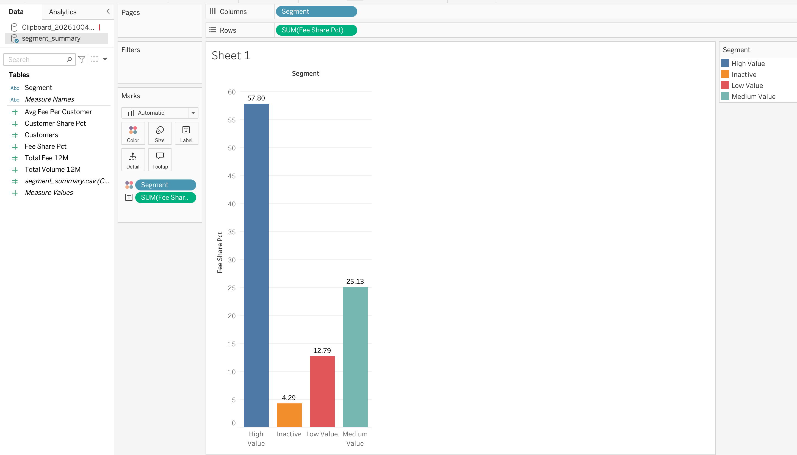

# Bankacılık İşlem ve Müşteri Analitiği

Sentetik bankacılık verisi üzerinde uçtan uca bir analitik projesi: müşteri segmentasyonu, işlem analitiği ve komisyon (fee) gelir analizi. PostgreSQL, Python ve Tableau kullanıldı.

> **İş sorusu:** Hangi müşteri segmentleri en yüksek finansal değeri üretiyor?

## Tek Bakışta Cevap



**High Value müşteriler müşteri tabanının %17,3'ünü oluşturuyor ama komisyon gelirinin %57,8'ini üretiyor**, yani müşteri paylarının yaklaşık 3,3 katı. High ve Medium Value müşteriler birlikte (müşterilerin %43,1'i) komisyon gelirinin %82,9'unu üretiyor.

| Segment | Müşteri | Müşteri % | İşlem Hacmi % | Komisyon Geliri % |
|---|---|---|---|---|
| High Value | 259 | 17,27 | 55,84 | 57,80 |
| Medium Value | 387 | 25,80 | 26,18 | 25,13 |
| Low Value | 647 | 43,13 | 14,07 | 12,79 |
| Inactive | 207 | 13,80 | 3,92 | 4,29 |

## Proje Özeti

Proje, bir bankanın müşteri ve işlem verisini simüle eder (1.500 müşteri, 2 yıllık işlem) ve müşteri değeri, kanal performansı ve gelir hakkındaki iş sorularını yanıtlar. SQL tabanlı bir segmentasyon modeli müşterileri **High Value, Medium Value, Low Value ve Inactive** olarak sınıflandırır ve her segmentin komisyon gelirindeki payını ölçer.

> Tüm veri **sentetiktir**, Python (Faker + NumPy) ile üretilmiştir. Gerçek müşteri verisi kullanılmamıştır.

## Kullanılan Teknolojiler

- **PostgreSQL:** CTE, window function (LAG, RANK, running total), view
- **Python:** pandas, NumPy, Faker, SQLAlchemy
- **Tableau Public:** dashboard

## Klasör Yapısı

```
├── data/
│   ├── raw/                  # üretilen CSV'ler (git'e eklenmez)
│   └── processed/            # dashboard için sorgu çıktıları
├── python/
│   ├── db.py
│   ├── generate_data.py
│   ├── load_to_db.py
│   ├── export_for_tableau.py
│   └── test_connection.py
├── sql/
│   ├── 00_schema.sql
│   ├── 01_data_quality.sql
│   ├── 02_customer_analytics.sql
│   ├── 03_transaction_analytics.sql
│   ├── 04_customer_segmentation.sql
│   ├── 05_window_functions.sql
│   └── 06_revenue_fee_analysis.sql
├── dashboard/screenshots/
├── docs/
│   ├── data_dictionary.md
│   ├── business_questions.md
│   └── key_insights.md
├── README.md
└── README_TR.md
```

## Veri Modeli

Beş tablodan oluşan yıldız şema: `customers`, `accounts`, `products`, `branches` ve `transactions` (fact tablo). Detaylar için [docs/data_dictionary.md](docs/data_dictionary.md).

## Müşteri Segmentasyonu

Son 12 aylık veriye dayanır:

| Segment | Kural |
|---|---|
| Inactive | Son 90 günde hiç işlemi yok |
| High Value | Aktif müşteriler içinde değer skoruna göre üst %20 |
| Medium Value | Sonraki %30 |
| Low Value | Kalan %50 |

Değer skoru = işlem hacminin yüzdelik sıralamasının %50'si + komisyon gelirinin yüzdelik sıralamasının %50'si.

## Analizler

- **Müşteri analitiği:** müşteri tabanı, ürün sahipliği, aktif/inaktif durumu, tercih edilen kanal
- **İşlem analitiği:** hacim, tutar, ortalama işlem, kanal performansı, aylık trendler
- **Window function'lar:** aylık büyüme (LAG), grup içi sıralama (RANK), kümülatif gelir (running total)
- **Gelir / komisyon analizi:** kanal, ürün, işlem tipi ve segment bazında komisyon; take rate

## Temel Bulgular

- **Gelir belirli bir gruba yoğunlaşmış.** High Value müşteriler (müşterilerin %17,3'ü) komisyon gelirinin %57,8'ini, işlem hacminin %55,8'ini üretiyor.
- **Ortalama bir High Value müşteri, ortalama müşterinin yaklaşık 3,35 katı komisyon kazandırıyor;** Low Value müşteri yaklaşık 0,30 katı kazandırıyor.
- **Low Value en kalabalık grup (müşterilerin %43,1'i) ama komisyon gelirinin yalnızca %12,8'ini üretiyor.**
- **Inactive müşteriler hâlâ son 12 aylık komisyon gelirinin %4,3'ünü taşıyor.** Bu, risk altındaki gelir ve geri kazanım fırsatı demek.

Tam analiz ve öneriler: [docs/key_insights.md](docs/key_insights.md)

## Nasıl Çalıştırılır

1. Repoyu klonla ve ortamı kur:
```bash
   git clone https://github.com/elfakb/banking-customer-intelligence.git
   cd banking-customer-intelligence
   python3 -m venv .venv && source .venv/bin/activate
   pip install -r requirements.txt
```
2. `banking_intelligence` adında bir PostgreSQL veritabanı oluştur, `.env.example` dosyasını `.env` olarak kopyala ve bağlantı bilgilerini doldur.
3. Veriyi üret ve yükle:
```bash
   python python/generate_data.py
   python python/load_to_db.py
```
4. SQL dosyalarını çalıştır (`04` dosyası, `05` ve `06`'nın ihtiyaç duyduğu view'ı oluşturur):
```bash
   psql -p <port> -d banking_intelligence -f sql/01_data_quality.sql
   psql -p <port> -d banking_intelligence -f sql/04_customer_segmentation.sql
   psql -p <port> -d banking_intelligence -f sql/02_customer_analytics.sql
   psql -p <port> -d banking_intelligence -f sql/03_transaction_analytics.sql
   psql -p <port> -d banking_intelligence -f sql/05_window_functions.sql
   psql -p <port> -d banking_intelligence -f sql/06_revenue_fee_analysis.sql
```
5. Dashboard verisini dışa aktar:
```bash
   python python/export_for_tableau.py
```

